# 在线考试系统

> 🎓 **计算机毕业设计 · 在线考试系统**
>
> 本仓库只放**项目介绍 + 运行截图**（截图是站点带水印的原图，存在仓库 `images/` 里）。
>
> 👉 **完整可运行源码 / 数据库脚本 / 部署文档：[点我获取](https://geekcode.top/archives/%E5%9C%A8%E7%BA%BF%E8%80%83%E8%AF%95%E7%B3%BB%E7%BB%9F?utm_source=github)**
>
> 💬 咨询微信：**ir9372**　|　🌐 更多项目：[极客代码 geekcode.top](https://geekcode.top/?utm_source=github)
>
> 📌 项目详情页：<https://geekcode.top/archives/%E5%9C%A8%E7%BA%BF%E8%80%83%E8%AF%95%E7%B3%BB%E7%BB%9F?utm_source=github>

<table><td width="230" align="center"> <b>扫码加微信 ir9372</b></td><td valign="middle">📦 源码 = 项目介绍 + 全部运行截图 + 数据库 + 部署文档 👉 点上方任意截图，直接跳到 <b>极客代码 geekcode.top</b> 详情页</td></table>

---

<h1>在线考试系统</h1>
<h2>项目概述</h2>

本项目旨在构建一个基于 Web 的在线考试系统，解决传统线下考试组织成本高、数据统计困难及资源复用率低的问题。系统采用前后端分离与模板渲染相结合的架构，核心功能涵盖课程管理、试卷生成、在线答题、错题分析及公告发布等模块。适用人群包括教师（负责试题录入与管理）、学生（参与考试与复习）及管理员（负责系统配置与用户管理）。技术架构上，后端基于 Spring Boot 框架，集成 MyBatis-Plus 进行数据持久化操作，使用 Apache Shiro 实现安全认证与授权，前端展示层采用 Thymeleaf 模板引擎，确保页面动态渲染的高效性与安全性。

<h2>技术架构</h2>
<h3>1. 总体架构设计</h3>

系统采用经典的 MVC 分层架构模式，结合服务端渲染技术，具体结构如下：

<a href="https://geekcode.top/archives/%E5%9C%A8%E7%BA%BF%E8%80%83%E8%AF%95%E7%B3%BB%E7%BB%9F?utm_source=github" title="查看完整源码">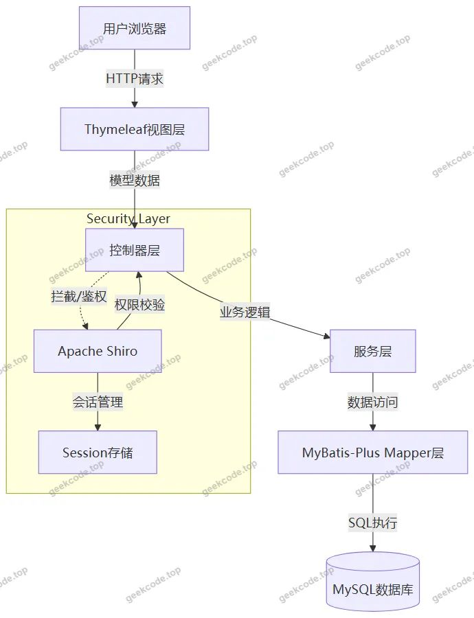</a>

<h3>2. 核心技术选型理由</h3>
<ul>
<li><strong>Spring Boot</strong>: 作为基础框架，提供自动配置和起步依赖，简化了开发流程，内置 Tomcat 容器便于快速部署。</li>
<li><strong>MyBatis-Plus</strong>: 在 MyBatis 基础上增强，提供了通用的 CRUD 接口和条件构造器，大幅减少重复 SQL 编写工作，提升数据访问层的开发效率。</li>
<li><strong>Apache Shiro</strong>: 轻量级且强大的 Java 安全框架，用于处理身份验证、授权、加密和会话管理，确保后台管理数据和前台用户隐私的安全。</li>
<li><strong>Thymeleaf</strong>: 现代化的服务器端 Java 模板引擎，能够自然地在 HTML 中嵌入动态数据，适合本项目的“vue-integrated”类型描述中涉及的模板渲染需求，保证页面生成的灵活性。</li>
<li><strong>MySQL</strong>: 关系型数据库，用于存储用户信息、试题库、考试记录及错题集等结构化数据，保证数据的一致性和完整性。</li>
</ul>
<h2>功能模块</h2>
<h3>1. 前台用户端</h3>

前台主要面向学生和老师用户，提供学习、考试及管理个人信息的入口。

<ul>
<li><strong>首页与导航</strong>：展示系统概览，包含试卷表、公告、课程三大核心导航入口。</li>
<li><strong>登录与注册</strong>：支持用户通过账号密码进行身份认证，新用户可注册获取访问权限。</li>
<li><strong>公告中心</strong>：查看系统发布的最新通知、考试安排或重要资讯列表及详情。</li>
<li><strong>课程模块</strong>：</li>
<li><strong>课程列表</strong>：浏览所有可用课程，查看课程基本信息。</li>
<li><strong>课程详情</strong>：查看特定课程的详细介绍及关联内容。</li>
<li><strong>课程留言</strong>：用户对课程发表评价或提问，查看历史留言列表。</li>
<li><strong>课程收藏</strong>：用户可将感兴趣的课程加入收藏夹，方便后续快速访问。</li>
<li><strong>在线考试模块</strong>：</li>
<li><strong>试卷列表</strong>：查看当前可用的考试试卷。</li>
<li><strong>试题列表</strong>：预览试卷中的具体题目内容。</li>
<li><strong>答题界面</strong>：进入具体的答题详情页，完成选择题或填空题作答。</li>
<li><strong>考试记录</strong>：查询个人的历史考试成绩和时间记录。</li>
<li><strong>错题分析</strong>：查看历次考试中答错的题目，辅助复习巩固。</li>
<li><strong>个人中心</strong>：</li>
<li><strong>个人信息管理</strong>：修改个人资料、密码等基础信息。</li>
<li><strong>老师列表</strong>：查看系统中的教师信息（根据路由 <code>laoshi</code> 推断可能具备此展示功能）。</li>
</ul>
<h3>2. 后台管理端</h3>

后台面向管理员，提供全系统的配置、数据维护及监控功能。

<ul>
<li><strong>系统配置</strong>：</li>
<li><strong>参数设置 (<code>config</code>)</strong>：管理系统全局运行参数。</li>
<li><strong>字典管理 (<code>dictionary</code>)</strong>：维护性别、上下架状态、科目分类等基础数据字典。</li>
<li><strong>用户管理</strong>：</li>
<li><strong>管理员管理 (<code>adminexam</code>)</strong>：创建、编辑或删除超级管理员账号。</li>
<li><strong>老师管理 (<code>laoshi</code>)</strong>：维护教师账户信息，分配权限。</li>
<li><strong>学生管理 (<code>yonghu</code>)</strong>：维护学生账户信息，重置密码或禁用账号。</li>
<li><strong>教学资源管理</strong>：</li>
<li><strong>课程管理 (<code>kecheng</code>)</strong>：增删改查课程信息，控制课程上下架状态。</li>
<li><strong>公告管理 (<code>gonggao</code>)</strong>：发布、编辑或删除系统公告。</li>
<li><strong>轮播图管理</strong>：虽然路由未直接显示，但截图提及“后台-轮播图”，推测存在首页图片广告位的配置功能。</li>
<li><strong>题库与考试管理</strong>：</li>
<li><strong>试卷管理 (<code>exampaper</code>)</strong>：创建试卷，设定考试时间、总分及关联题目。</li>
<li><strong>试题管理 (<code>examquestion</code>)</strong>：录入单选题、多选题等具体题目，设置正确答案及分值。</li>
<li><strong>班级字典 (<code>dictionaryBanji</code>)</strong>：维护班级信息，用于关联学生与考试范围。</li>
<li><strong>数据统计与维护</strong>：</li>
<li><strong>考试记录 (<code>examrecord</code>)</strong>：查看所有用户的考试提交记录。</li>
<li><strong>答题详情 (<code>examredetails</code>)</strong>：深入查看单次考试的具体得分明细。</li>
<li><strong>错题表 (<code>examrewrongquestion</code>)</strong>：统计高频错题，辅助教学改进。</li>
<li><strong>课程收藏 (<code>kechengCollection</code>)</strong>：查看和管理用户的收藏数据。</li>
<li><strong>课程留言 (<code>kechengLiuyan</code>)</strong>：审核、回复或删除用户提交的课程留言。</li>
</ul>
<h2>用户角色与权限</h2>

系统基于 Apache Shiro 实现细粒度的权限控制，主要划分为以下三类角色：

<table>
<thead>
<tr>
<th align="left">角色名称</th>
<th align="left">标识代码 (推测)</th>
<th align="left">权限描述</th>
</tr>
</thead>
<tbody><tr>
<td align="left"><strong>管理员</strong></td>
<td align="left">Admin</td>
<td align="left"><strong>最高权限</strong>。拥有后台所有模块的访问权，包括用户管理、系统配置、题库维护、数据统计及内容发布。不可直接参与前台考试。</td>
</tr>
<tr>
<td align="left"><strong>老师</strong></td>
<td align="left">Teacher</td>
<td align="left"><strong>内容生产者</strong>。在前台可查看公告、课程；在后台（若开放部分权限）或特定模块下，主要负责试题录入、试卷创建、批改或查看自己负责班级的考试记录。根据路由 <code>/laoshi</code> 的存在，老师在系统中具有独立的实体身份。</td>
</tr>
<tr>
<td align="left"><strong>学生</strong></td>
<td align="left">Student</td>
<td align="left"><strong>使用者</strong>。仅能访问前台功能。包括注册登录、浏览公告、收藏课程、参加在线考试、查看个人成绩、复习错题及个人信息管理。无后台访问权限。</td>
</tr>
</tbody></table>

<em>注：具体权限边界依据 Shiro 配置文件及 Controller 注解确定，上述为基于常规在线考试系统及现有路由的逻辑推导。</em>

<h2>项目特色与创新点</h2>
<ol>
<li>
<strong>闭环的学习反馈机制</strong>：
   不同于简单的电子试卷，系统集成了“错题表” (<code>examrewrongquestion</code>) 和“答题详情” (<code>examredetails</code>) 模块。学生考后不仅能看到分数，还能精准定位错误知识点，形成“练习-测试-纠错-再练习”的学习闭环。

</li>
<li>
<strong>灵活的资源聚合能力</strong>：
   引入“课程收藏” (<code>kechengCollection</code>) 功能，允许用户根据个人兴趣建立私有知识库。结合“课程留言” (<code>kechengLiuyan</code>)，促进了师生之间围绕课程内容的互动，增强了社区属性。

</li>
<li>
<strong>标准化的数据字典管理</strong>：
   后台设计了完善的字典体系（如 <code>dictionarySex</code>, <code>dictionaryShangxia</code>, <code>dictionaryKemu</code>），将枚举值（如性别、上架状态、科目类别）从代码硬编码中剥离，实现了业务数据的动态配置，提升了系统的可维护性和扩展性。

</li>
<li>
<strong>安全可靠的权限隔离</strong>：
   采用 Shiro 框架对前后台进行严格的路由隔离。后台敏感操作（如删除试题、管理用户）仅限管理员角色，防止误操作导致的数据丢失；前台用户数据（如考试记录）相互隔离，保障隐私安全。

</li>
</ol>
<h2>部署环境</h2>

为确保系统正常运行，建议配置以下软件环境：

<ul>
<li><strong>操作系统</strong>：Windows 10/11, Linux (CentOS 7+, Ubuntu 20.04+) 或 macOS。</li>
<li><strong>Java 运行环境</strong>：JDK 1.8 或更高版本（推荐 JDK 8 LTS 以兼容 Spring Boot 常见版本）。</li>
<li><strong>数据库</strong>：MySQL 5.7 或 MySQL 8.0+。需初始化数据库并导入对应的 SQL 脚本以建立表结构。</li>
<li><strong>构建工具</strong>：Maven 3.6+（用于依赖管理和项目打包）。</li>
<li><strong>Web 服务器</strong>：内置 Tomcat（由 Spring Boot Starter Web 提供），无需额外安装独立 Tomcat；生产环境建议使用 Nginx 反向代理。</li>
<li><strong>浏览器</strong>：Chrome, Firefox, Edge 等现代主流浏览器。</li>
</ul>

<strong>启动步骤简述</strong>：

<ol>
<li>修改 <code>application.yml</code> 或 <code>application.properties</code> 中的数据库连接 URL、用户名和密码。</li>
<li>使用 Maven 命令 <code>mvn clean package</code> 打包项目生成 JAR 文件。</li>
<li>执行 <code>java -jar target/project-name.jar</code> 启动应用。</li>
<li>访问默认端口（通常为 8080）进入前台首页或后台登录页。</li>
</ol>
<h2>五、技术特性</h2>
<ul>
<li>前后端集成部署，前端资源打包至后端 static 目录</li>
<li>使用 MyBatis-Plus 简化数据访问层开发</li>
<li>集成 Shiro 权限框架实现角色权限控制</li>
</ul>
<h2>六、功能模块截图</h2>
<h3>前台用户端</h3>
<h4>前台首页</h4>

<a href="https://geekcode.top/archives/%E5%9C%A8%E7%BA%BF%E8%80%83%E8%AF%95%E7%B3%BB%E7%BB%9F?utm_source=github" title="查看完整源码">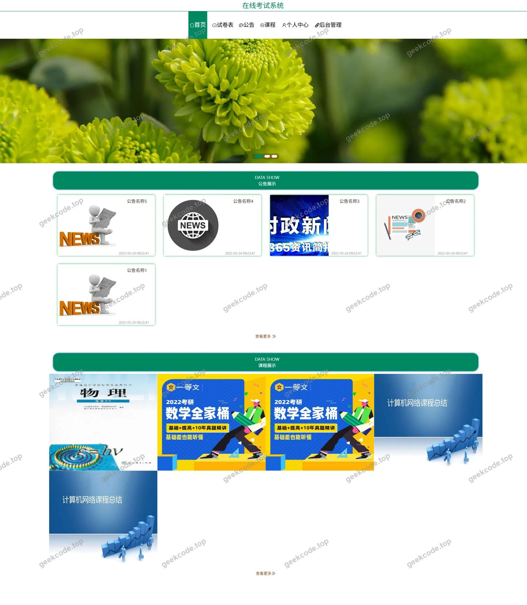</a>

<h4>前台登录页</h4>

<h4>前台注册页</h4>

<a href="https://geekcode.top/archives/%E5%9C%A8%E7%BA%BF%E8%80%83%E8%AF%95%E7%B3%BB%E7%BB%9F?utm_source=github" title="查看完整源码">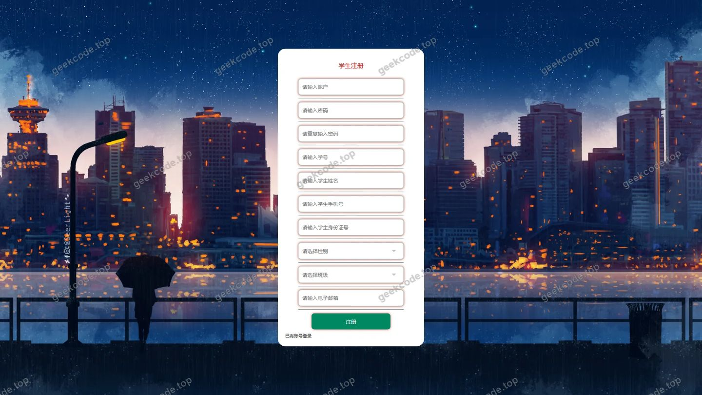</a>

<h4>前台-公告列表</h4>

<a href="https://geekcode.top/archives/%E5%9C%A8%E7%BA%BF%E8%80%83%E8%AF%95%E7%B3%BB%E7%BB%9F?utm_source=github" title="查看完整源码">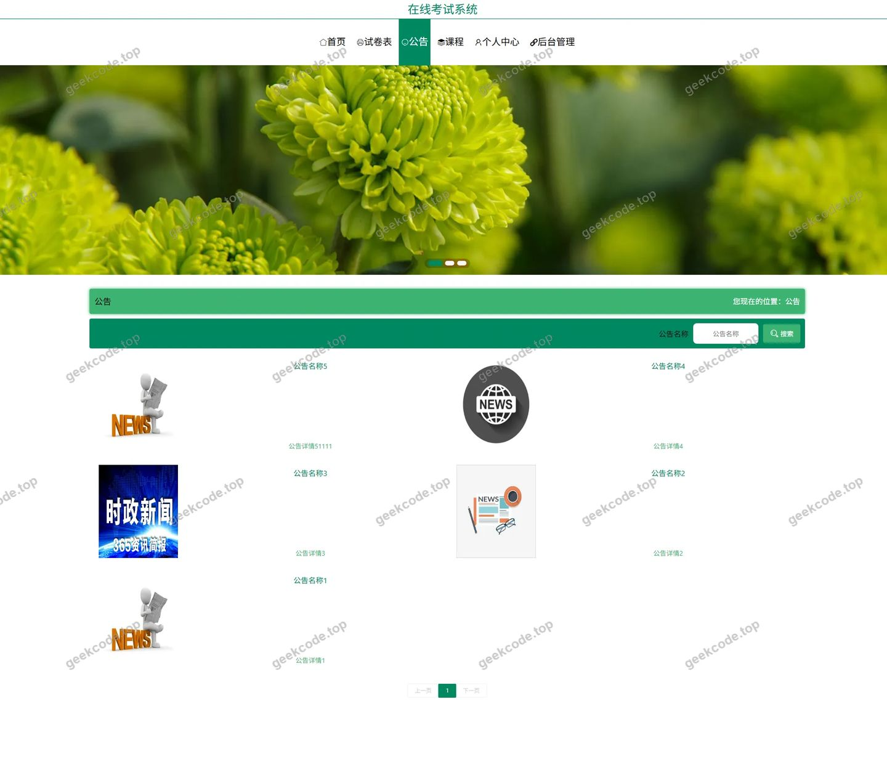</a>

<h4>前台-课程列表</h4>

<h4>前台-试题列表</h4>

<a href="https://geekcode.top/archives/%E5%9C%A8%E7%BA%BF%E8%80%83%E8%AF%95%E7%B3%BB%E7%BB%9F?utm_source=github" title="查看完整源码">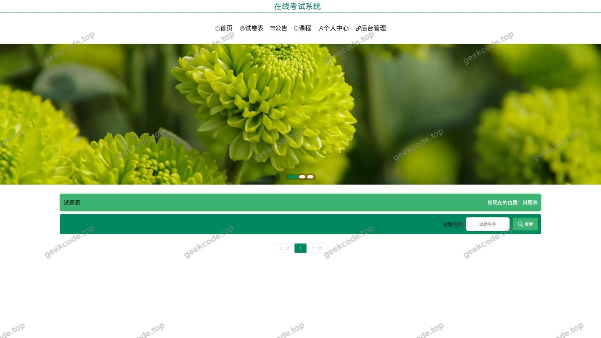</a>

<h4>前台-答题详情列表</h4>

<a href="https://geekcode.top/archives/%E5%9C%A8%E7%BA%BF%E8%80%83%E8%AF%95%E7%B3%BB%E7%BB%9F?utm_source=github" title="查看完整源码">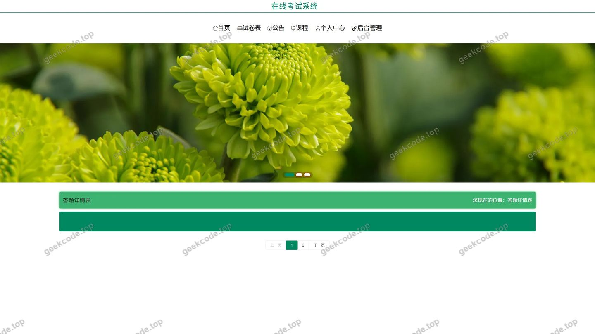</a>

<h4>前台-课程留言列表</h4>

<a href="https://geekcode.top/archives/%E5%9C%A8%E7%BA%BF%E8%80%83%E8%AF%95%E7%B3%BB%E7%BB%9F?utm_source=github" title="查看完整源码">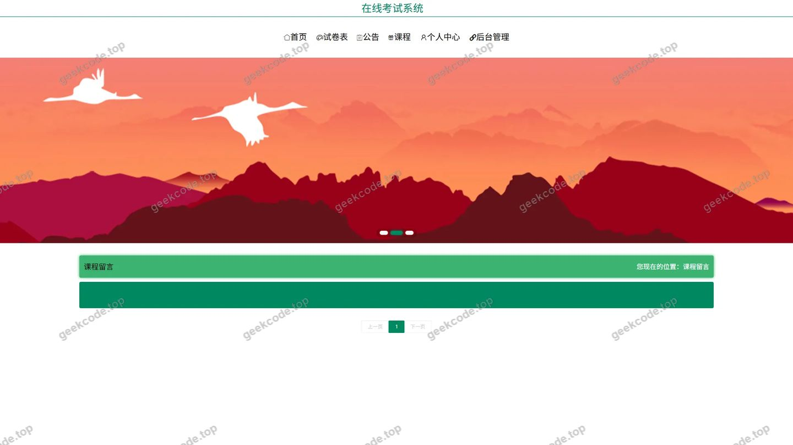</a>

<h4>前台-老师列表</h4>

<a href="https://geekcode.top/archives/%E5%9C%A8%E7%BA%BF%E8%80%83%E8%AF%95%E7%B3%BB%E7%BB%9F?utm_source=github" title="查看完整源码">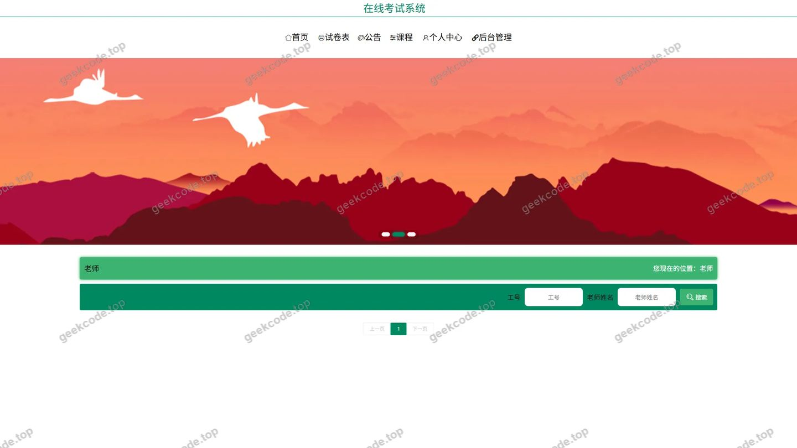</a>

<h4>前台个人中心</h4>

<a href="https://geekcode.top/archives/%E5%9C%A8%E7%BA%BF%E8%80%83%E8%AF%95%E7%B3%BB%E7%BB%9F?utm_source=github" title="查看完整源码">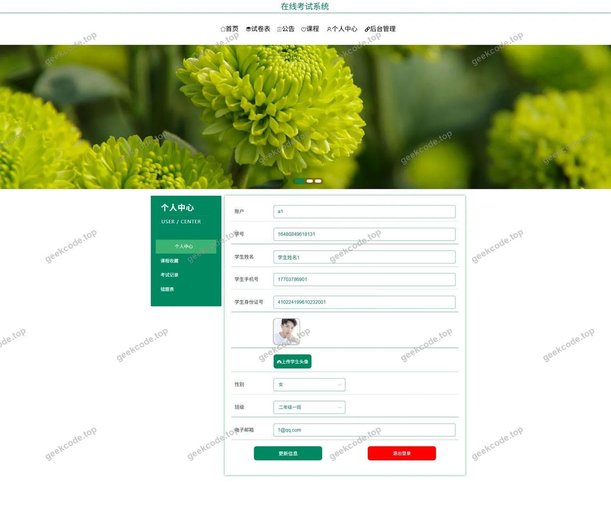</a>

<h4>前台-试卷表列表</h4>

<a href="https://geekcode.top/archives/%E5%9C%A8%E7%BA%BF%E8%80%83%E8%AF%95%E7%B3%BB%E7%BB%9F?utm_source=github" title="查看完整源码">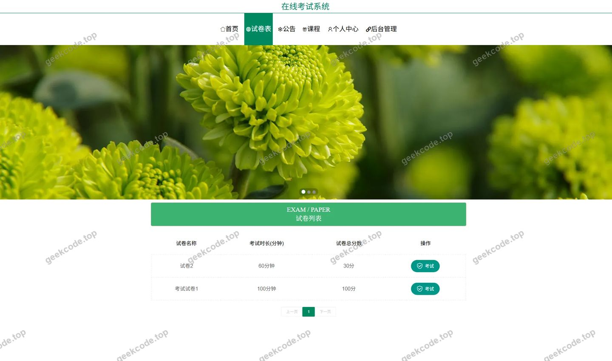</a>

<h4>前台-考试记录列表</h4>

<a href="https://geekcode.top/archives/%E5%9C%A8%E7%BA%BF%E8%80%83%E8%AF%95%E7%B3%BB%E7%BB%9F?utm_source=github" title="查看完整源码">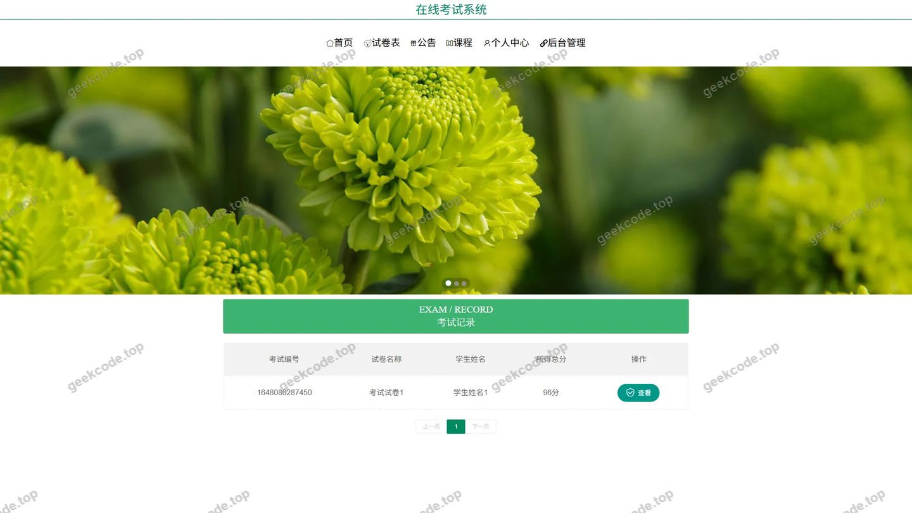</a>

<h4>前台-错题表列表</h4>

<a href="https://geekcode.top/archives/%E5%9C%A8%E7%BA%BF%E8%80%83%E8%AF%95%E7%B3%BB%E7%BB%9F?utm_source=github" title="查看完整源码">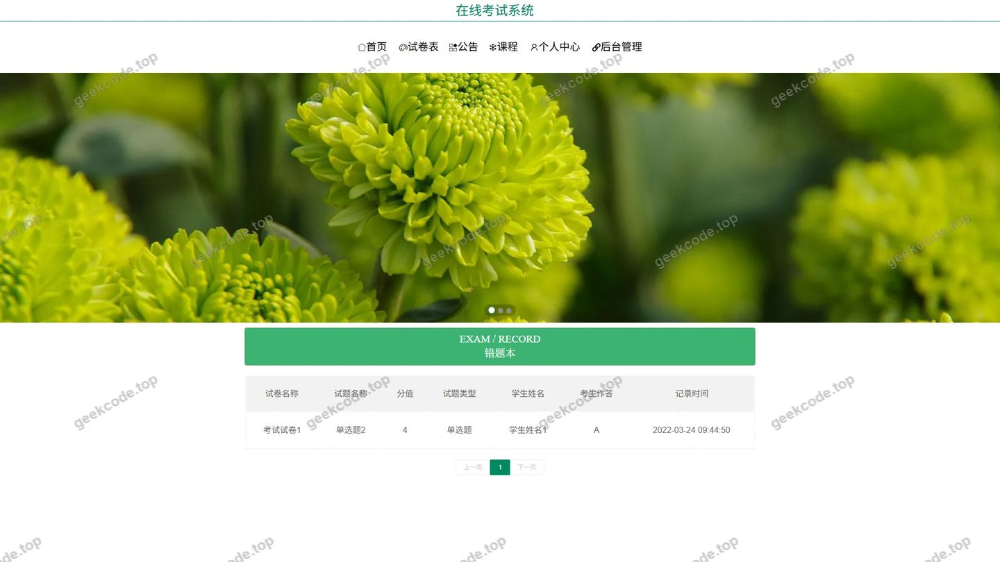</a>

<h4>前台-课程收藏列表</h4>

<h4>前台-试卷表-详情</h4>

<a href="https://geekcode.top/archives/%E5%9C%A8%E7%BA%BF%E8%80%83%E8%AF%95%E7%B3%BB%E7%BB%9F?utm_source=github" title="查看完整源码">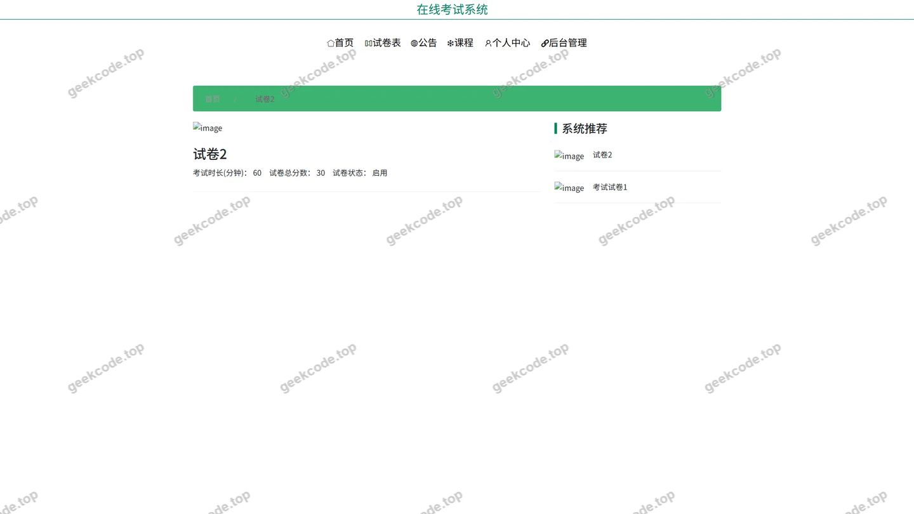</a>

<h4>前台-公告-详情</h4>

<a href="https://geekcode.top/archives/%E5%9C%A8%E7%BA%BF%E8%80%83%E8%AF%95%E7%B3%BB%E7%BB%9F?utm_source=github" title="查看完整源码">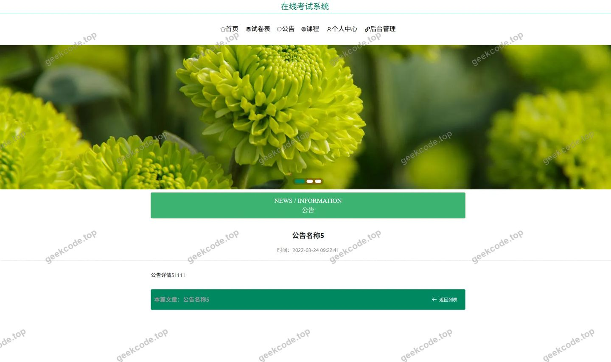</a>

<h4>前台-课程-详情</h4>

<a href="https://geekcode.top/archives/%E5%9C%A8%E7%BA%BF%E8%80%83%E8%AF%95%E7%B3%BB%E7%BB%9F?utm_source=github" title="查看完整源码">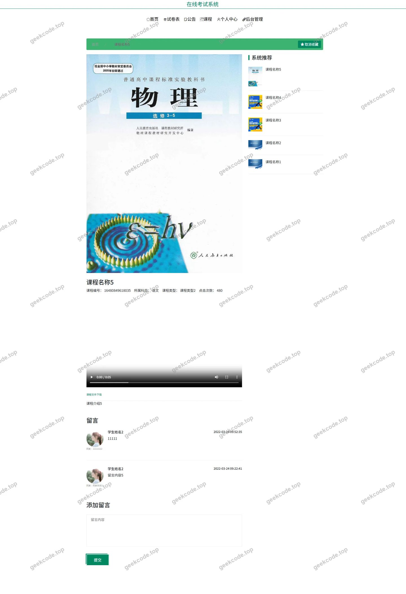</a>

<h4>前台-课程收藏-详情</h4>

<a href="https://geekcode.top/archives/%E5%9C%A8%E7%BA%BF%E8%80%83%E8%AF%95%E7%B3%BB%E7%BB%9F?utm_source=github" title="查看完整源码">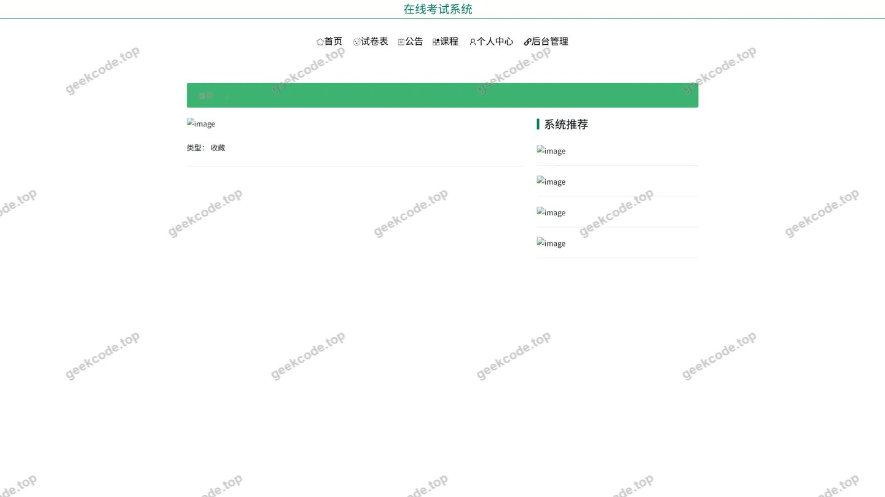</a>

<h3>后台管理端</h3>
<h4>后台-考试管理</h4>

<a href="https://geekcode.top/archives/%E5%9C%A8%E7%BA%BF%E8%80%83%E8%AF%95%E7%B3%BB%E7%BB%9F?utm_source=github" title="查看完整源码">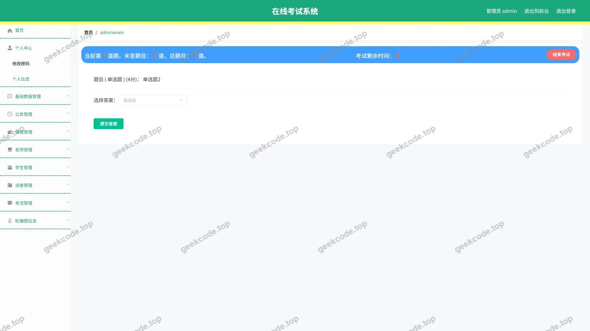</a>

<h4>后台-系统配置</h4>

<a href="https://geekcode.top/archives/%E5%9C%A8%E7%BA%BF%E8%80%83%E8%AF%95%E7%B3%BB%E7%BB%9F?utm_source=github" title="查看完整源码">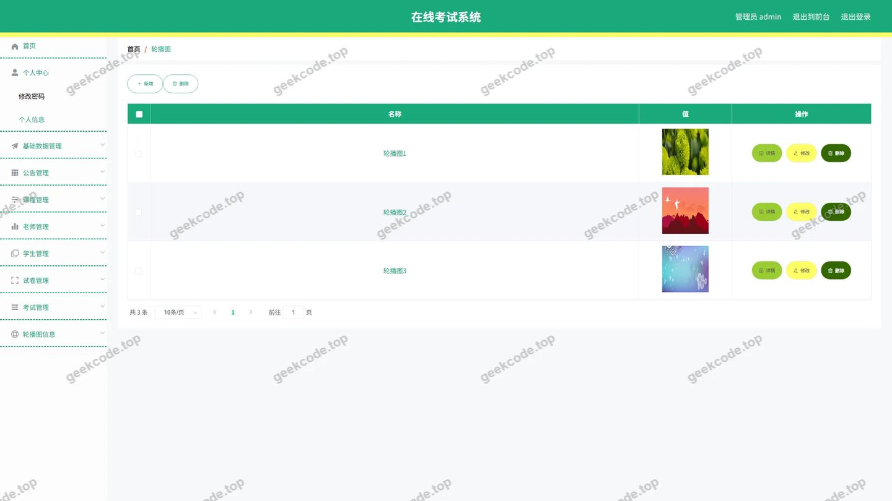</a>

<h4>后台-试卷</h4>

<a href="https://geekcode.top/archives/%E5%9C%A8%E7%BA%BF%E8%80%83%E8%AF%95%E7%B3%BB%E7%BB%9F?utm_source=github" title="查看完整源码">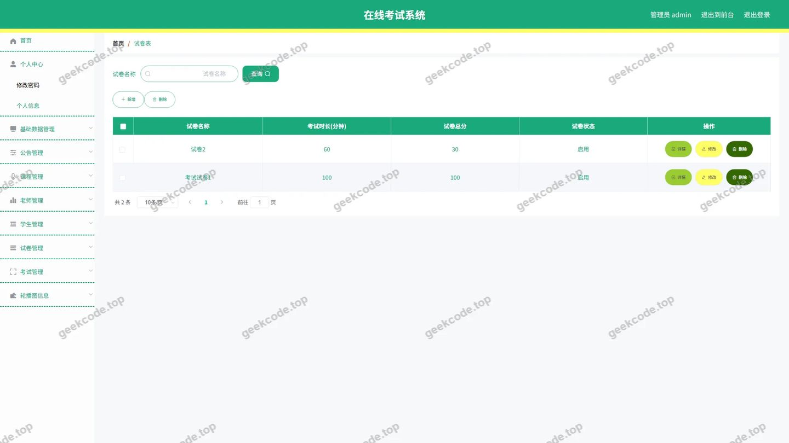</a>

<h4>后台-试题</h4>

<a href="https://geekcode.top/archives/%E5%9C%A8%E7%BA%BF%E8%80%83%E8%AF%95%E7%B3%BB%E7%BB%9F?utm_source=github" title="查看完整源码">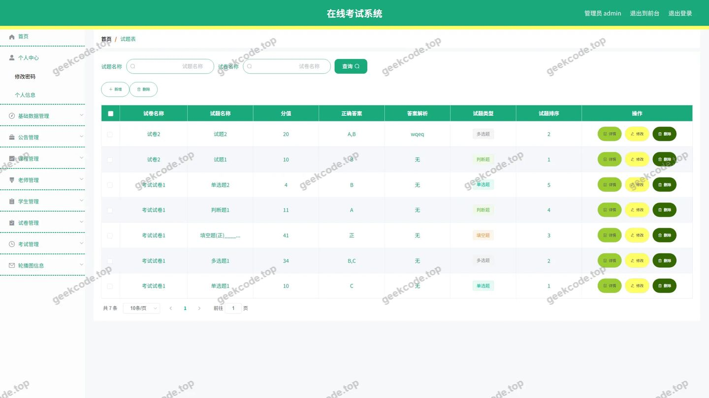</a>

<h4>后台-考试记录</h4>

<a href="https://geekcode.top/archives/%E5%9C%A8%E7%BA%BF%E8%80%83%E8%AF%95%E7%B3%BB%E7%BB%9F?utm_source=github" title="查看完整源码">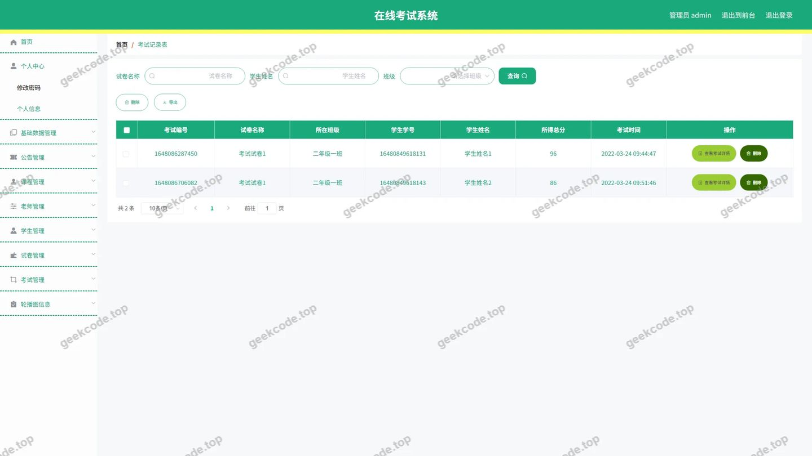</a>

<h4>后台-答题详情</h4>

<a href="https://geekcode.top/archives/%E5%9C%A8%E7%BA%BF%E8%80%83%E8%AF%95%E7%B3%BB%E7%BB%9F?utm_source=github" title="查看完整源码">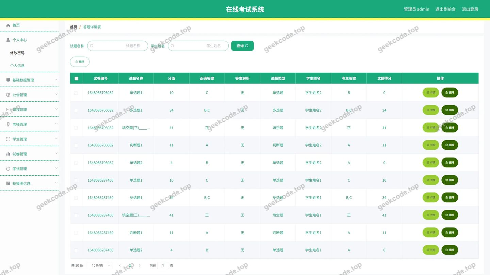</a>

<h4>后台-错题</h4>

<a href="https://geekcode.top/archives/%E5%9C%A8%E7%BA%BF%E8%80%83%E8%AF%95%E7%B3%BB%E7%BB%9F?utm_source=github" title="查看完整源码">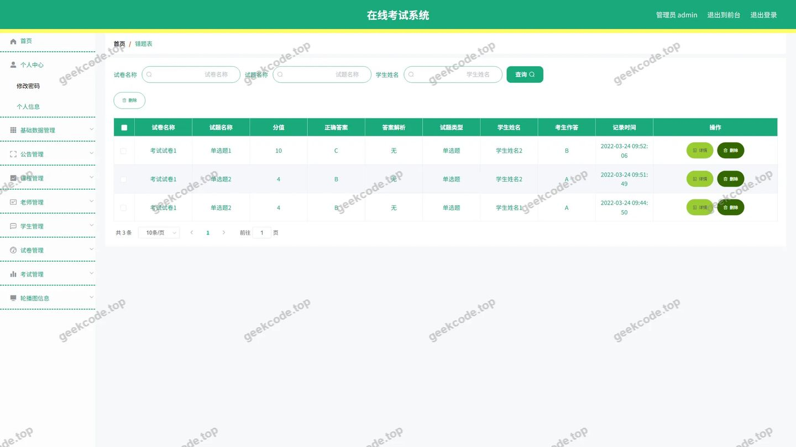</a>

<h4>后台-公告</h4>

<a href="https://geekcode.top/archives/%E5%9C%A8%E7%BA%BF%E8%80%83%E8%AF%95%E7%B3%BB%E7%BB%9F?utm_source=github" title="查看完整源码">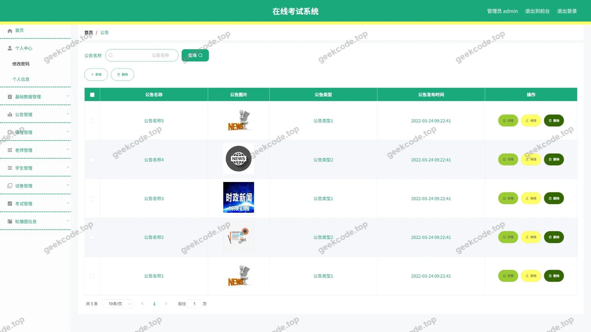</a>

<h4>后台首页</h4>

<a href="https://geekcode.top/archives/%E5%9C%A8%E7%BA%BF%E8%80%83%E8%AF%95%E7%B3%BB%E7%BB%9F?utm_source=github" title="查看完整源码">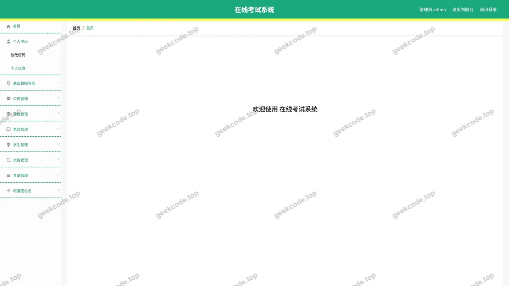</a>

<h4>后台-课程</h4>

<a href="https://geekcode.top/archives/%E5%9C%A8%E7%BA%BF%E8%80%83%E8%AF%95%E7%B3%BB%E7%BB%9F?utm_source=github" title="查看完整源码">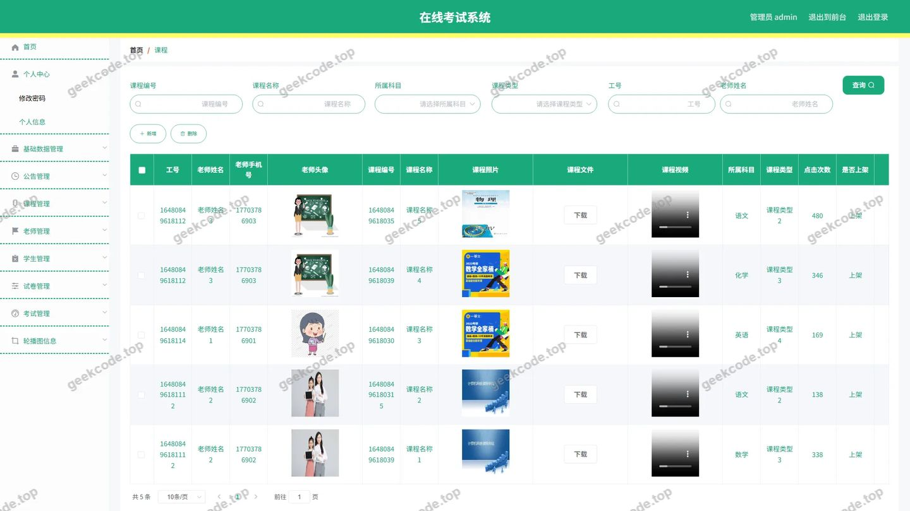</a>

<h4>后台-课程收藏</h4>

<a href="https://geekcode.top/archives/%E5%9C%A8%E7%BA%BF%E8%80%83%E8%AF%95%E7%B3%BB%E7%BB%9F?utm_source=github" title="查看完整源码">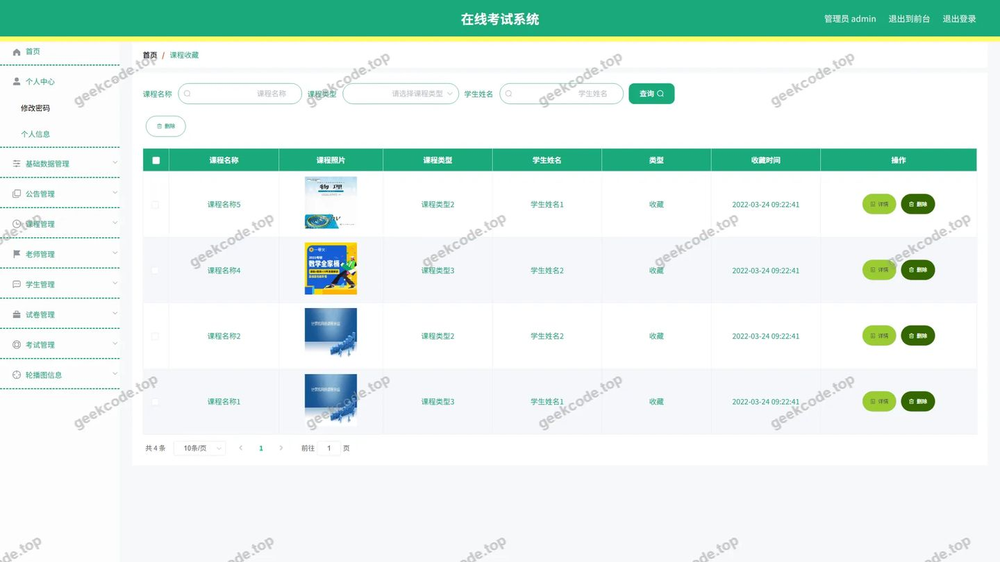</a>

<h4>后台-课程留言</h4>

<a href="https://geekcode.top/archives/%E5%9C%A8%E7%BA%BF%E8%80%83%E8%AF%95%E7%B3%BB%E7%BB%9F?utm_source=github" title="查看完整源码">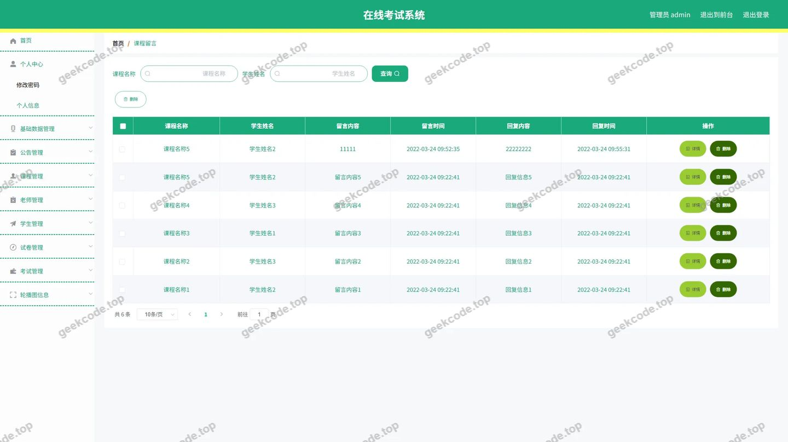</a>

<h4>后台-老师</h4>

<a href="https://geekcode.top/archives/%E5%9C%A8%E7%BA%BF%E8%80%83%E8%AF%95%E7%B3%BB%E7%BB%9F?utm_source=github" title="查看完整源码">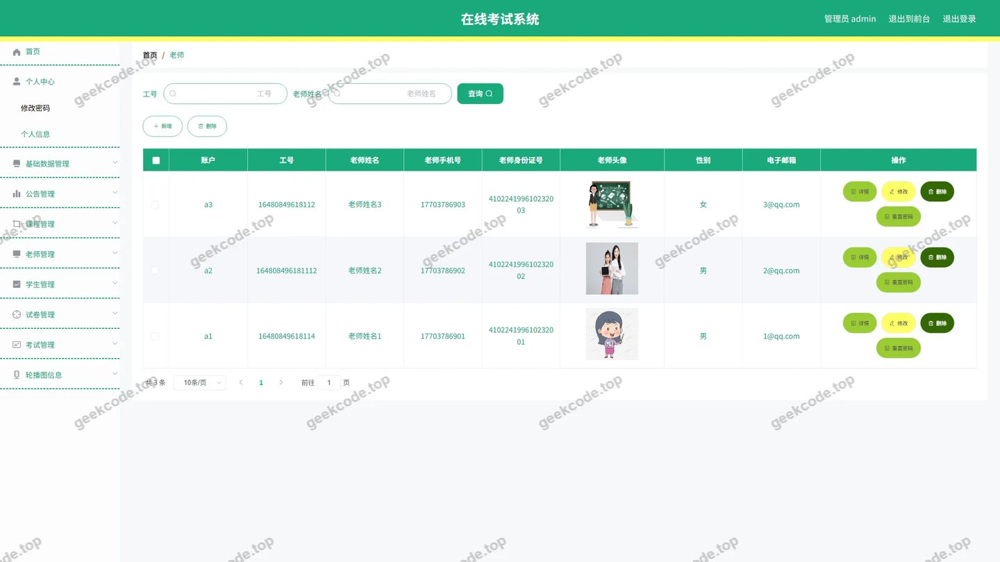</a>

<h4>后台-登录</h4>

---

## 获取完整源码

| 项目 | 说明 |
| --- | --- |
| 项目名 | 在线考试系统 |
| 运行截图 | 本文 33 张（站点带水印原图，仓库 `images/` 目录） |
| 完整源码 | [https://geekcode.top/archives/%E5%9C%A8%E7%BA%BF%E8%80%83%E8%AF%95%E7%B3%BB%E7%BB%9F?utm_source=github](https://geekcode.top/archives/%E5%9C%A8%E7%BA%BF%E8%80%83%E8%AF%95%E7%B3%BB%E7%BB%9F?utm_source=github) |
| 咨询微信 | **ir9372**（备注：jingpin-yuanma） |
| 更多项目 | [极客代码 geekcode.top](https://geekcode.top/?utm_source=github) |

> 需要源码、部署、改配置、跑不起来等问题，加微信 ir9372 沟通，说明项目名即可。
